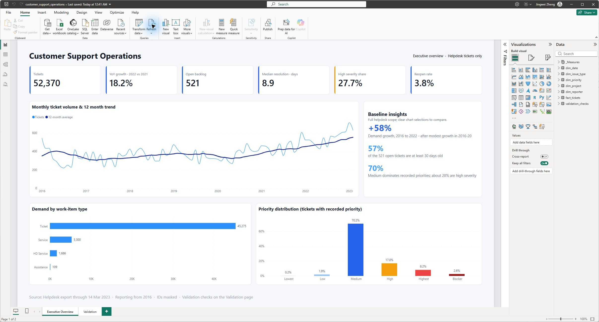
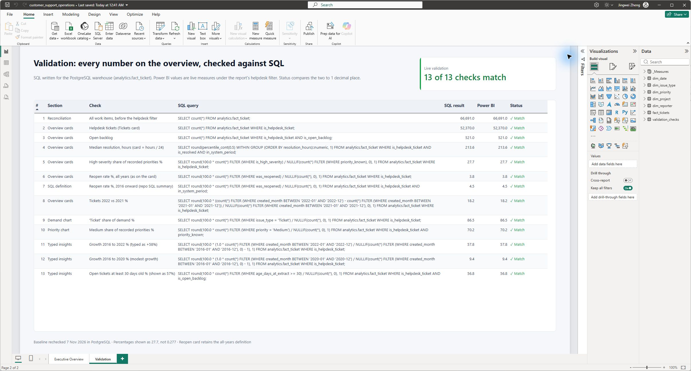

# Customer Support Operations Reporting

An AI-assisted portfolio learning project exploring customer-support demand, resolution times and ageing backlog using a public, anonymised helpdesk dataset. The project includes a PostgreSQL reporting pipeline, a Power BI report and validation checks.

## Authorship and learning

I chose the business questions and dataset and built this project with extensive AI assistance from Claude and Codex across the SQL, Python code and documentation. I followed AI-generated guidance to set up and run the project.

I used this as a learning project to practise Python, PostgreSQL setup and SQL, Power BI, Git, Docker, Claude Code and Codex. This included learning how to review AI-generated work and check reporting outputs against the source data.

### AI contributors

- **Claude Code (Anthropic)**
- **Codex (OpenAI)**

## Business questions

- How has customer-support demand changed?
- How long do resolved tickets take, and how does that vary by priority?
- Which open cases need follow-up at the extract date?

## Findings

The dataset describes one software company's helpdesk, ending 14 March 2023.

| Finding | Reporting implication |
|---|---|
| Annual helpdesk demand rose from 4,013 tickets in 2016 to 6,331 in 2022, a 57.8% increase. | Review the demand trend when planning support capacity. |
| Median resolution for resolved tickets created from 2016 is 213.6 elapsed hours, or 8.9 days. | Use the median alongside the distribution; a long tail makes the mean less representative of a typical case. |
| At the extract date, 296 of 521 open tickets were at least 30 days old: 56.8%. | Review aged cases by priority and current status to decide the next follow-up. |

I would use these findings to start a conversation about capacity and case follow-up. The data shows patterns, but it does not establish what caused them. The [metric definitions](docs/metric_definitions.md) explain the populations and denominators.

## Workflow

`issues.csv` → Python cleaning and validation → PostgreSQL raw, staging and analytics layers → Power BI fact table and dimensions → measures and report visuals.

- [SQL](sql/): source tables, transformations, dimensions, ticket fact and focused reporting queries.
- [Power BI build guide](dashboard/README.md): model relationships, report layout and validation steps.
- [DAX measures](dashboard/dax_measures.md): calculations for the reporting model.
- [Data source](docs/data_source.md): provenance, licence and limitations.

The fact table contains one row per work item. A helpdesk filter selects 52,370 customer-facing tickets from 66,691 work items. Date, priority, work-item type, project and requester dimensions support filtering. The report uses the fact table and these relationships; separate summary exports provide SQL checks.

## Open the report

Open [the Power BI report](dashboard/customer_support_operations.pbix) in Power BI Desktop. The file includes its imported data and has two pages:

- **Executive Overview:** demand trends, backlog, resolution time and priority mix.
- **Validation:** 13 checks against SQL reference values, with a status for each check.



The [report guide](dashboard/README.md) explains the model and how to refresh it from local CSVs. The [DAX reference](dashboard/dax_measures.md) explains the report's measures. The pipeline also calculates aged-backlog fields for further analysis; the report currently shows the overall open-backlog count.

## Validation

The report includes a Validation page comparing 13 Power BI calculations with stored SQL reference values. The pipeline also includes checks for unique IDs, valid dates and known labels. These checks assess consistency between the reporting outputs; their usefulness depends on appropriate metric definitions and reliable source data.



## Reproduce

Requirements: Python 3.12, Docker with PostgreSQL available, and Power BI Desktop for report authoring. Run these commands in PowerShell from the repository root:

```powershell
py -3.12 -m venv .venv
.\.venv\Scripts\python.exe -m pip install -e ".[dev]"
Copy-Item .env.example .env
```

The default database is `customer_ops_bi` on `localhost:5433`. Set the database password in the local `.env`, then start PostgreSQL and wait until `docker compose ps` reports it healthy:

```powershell
docker compose up -d
.\.venv\Scripts\python.exe scripts/pipeline.py all
.\.venv\Scripts\python.exe -m pytest
```

To refresh Power BI, set the `ExportFolder` parameter to your local `dashboard/exports` folder, then select **Refresh**. All six source queries use that folder.

The runner also accepts `data`, `load`, `sql`, `dashboard-export`, `dashboard-checks` and `validate` individually. `load`, `sql`, `dashboard-export` and `dashboard-checks` need PostgreSQL. `validate` checks exported CSVs without a running database; generate them first. Rebuild the exports before refreshing the CSV-based Power BI report.

## Reading the numbers correctly

- Service metrics use tickets created from 2016 because earlier records include migrated tickets with bulk closures.
- Priority percentages exclude unknown priorities; missing priority is common in earlier records.
- Resolution times are elapsed hours, including weekends, rather than working hours.
- Backlog is a snapshot at 14 March 2023. A creation-year filter selects a cohort still open at that snapshot; it does not reconstruct the backlog in that year.
- 2023 is a partial year and is excluded from full-year growth comparisons.

## Licence

The code and documentation use the [MIT licence](LICENSE). The source dataset and derived data retain [CC BY 4.0 attribution requirements](THIRD_PARTY_NOTICES.md).
