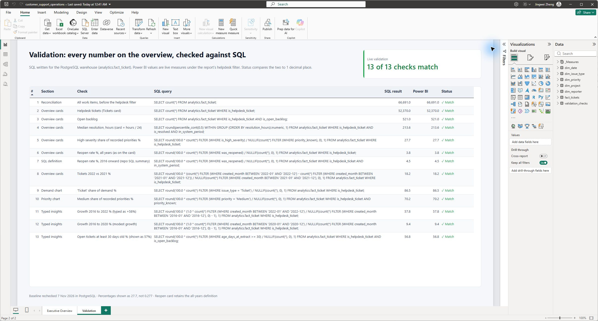

# Power BI report

I built this report to help a support manager understand demand, service performance and outstanding work. Open [customer_support_operations.pbix](customer_support_operations.pbix) in Power BI Desktop. It contains imported data, so Docker is needed to rebuild the warehouse, not to read the saved report.

## Executive Overview

The written baseline insights describe the full helpdesk scope and stay fixed when a chart selection filters the cards and visuals. Clear chart selections before comparing with these insights.

The overview shows ticket count, 2022 versus 2021 growth, open backlog, median resolution days, high-severity share and reopen rate. A monthly line compares ticket volume with a trailing 12-month average. The other charts show demand by work-item type and the distribution of recorded priorities.

I apply `is_helpdesk_ticket = TRUE` at report level. The demand trend starts in 2016; the growth card selects 2022. The priority distribution excludes unknown priority.

## Validation

I use a second page to compare 13 reporting values with fixed baselines. Each row shows the check, its PostgreSQL query, the baseline result, the live Power BI measure and the match status. A card counts the matching checks.

The [check catalogue](validation/validation_checks.csv), [queries](validation/validation_queries.sql) and [saved results](validation/validation_results.json) document the 13 checks. The page compares live DAX measures with stored SQL results; it doesn't run SQL inside Power BI.

The 13-row `validation_checks` table is embedded in the report and disconnected from the fact and dimensions. Its baseline values stay fixed when the fact is refreshed. I reconcile it at the unfiltered helpdesk scope; changing report filters can change the live measures without changing the baselines.

The pipeline re-runs the 13 SQL queries against PostgreSQL (`dashboard-checks`); the latest comparison is in [PostgreSQL baseline validation](../reports/powerbi_validation.json).

## Model

The model contains one ticket fact and five dimensions, plus `_Measures` and the disconnected validation table. The five relationships are active, many-to-one, with single-direction filtering from each dimension to the fact:

| Fact column | Dimension key |
|---|---|
| `fact_tickets[created_date]` | `dim_date[full_date]` |
| `fact_tickets[priority]` | `dim_priority[priority]` |
| `fact_tickets[issue_type]` | `dim_issue_type[issue_type]` |
| `fact_tickets[project_key]` | `dim_project[project_key]` |
| `fact_tickets[reporter_id]` | `dim_reporter[reporter_id]` |

There is no inactive relationship for `resolved_date`. `dim_date[Month Start]` is a calculated column: `DATE ( dim_date[year], dim_date[month], 1 )`.

The fact grain is one row per work item, including internal work. The report filter selects 52,370 helpdesk tickets from 66,691 work items. The [DAX measures](dax_measures.md) and [metric definitions](../docs/metric_definitions.md) show the calculation rules.

## Reading the headline values

- 52,370 helpdesk tickets; 23,100 with known priority; 6,402 high severity.
- 521 open cases at the extract.
- Median resolution of 213.64 elapsed hours / 8.9 days for resolved tickets created from 2016.
- 1,974 reopened tickets / 52,370 tickets = 3.8% to one decimal place.
- 27.7% high-severity share among known priorities.
- 18.2% demand growth in 2022 versus 2021.

Demand grew 9.4% between 2016 and 2020, followed by stronger growth in 2021 and 2022. I describe the earlier period as modest growth.

The 4.5% reopen figure uses tickets created from 2016; the overview's 3.8% uses all-history helpdesk tickets. Both can be correct because their populations differ. Likewise, the overview's rounded 57% aged-backlog insight corresponds to 56.8% in the validation page.

## Refresh

1. Rebuild the warehouse and CSV exports using the root README. The pipeline writes the six fact/dimension files to `dashboard/exports/`.
2. In Power BI Desktop, select **Transform data > Edit parameters**. Set `ExportFolder` to the full path of that folder on your machine. This is the only source-folder setting; every CSV query uses it.
3. Select **OK**, apply the changes if prompted, then select **Refresh**. The queries read UTF-8 CSVs and take field names from the header row. The fact table matches the 35-column export, including the three aged-backlog fields.
4. Check the headline figures and the Validation page at the unfiltered helpdesk scope. All 13 checks should match. If you deliberately change the source or a metric definition, recalculate the baselines before treating a difference as an error.

Dates are Date, the `is_` flags plus `priority_known` and `in_system_period` are True/False, ages and durations are Decimal Number, and `backlog_age_bucket_order` is Whole Number. Keep matching relationship-key types when changing the model.

The embedded validation table does not require an external CSV path. The separate file under `validation/` is its readable check catalogue. SQL summary exports are reconciliation references, not imported report tables.

The SQL export includes `is_backlog_30_plus`, `backlog_age_bucket` and `backlog_age_bucket_order` for further analysis. An aged-backlog visual should reconcile to 296 cases aged at least 30 days, including 95 high-severity cases. Its cutoff remains 14 March 2023; a creation-date slicer narrows the snapshot to a cohort.
